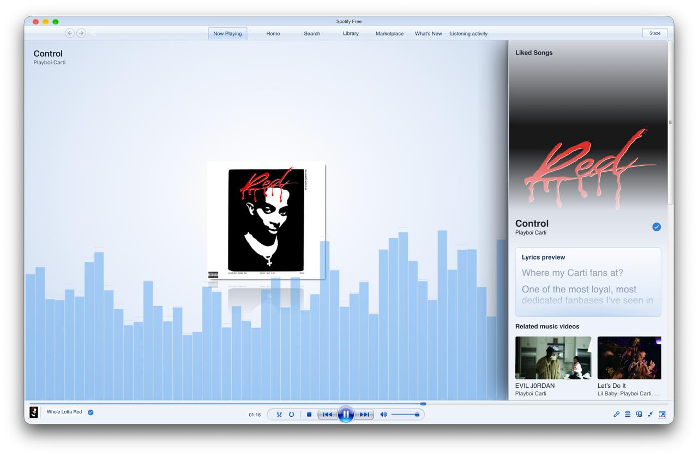
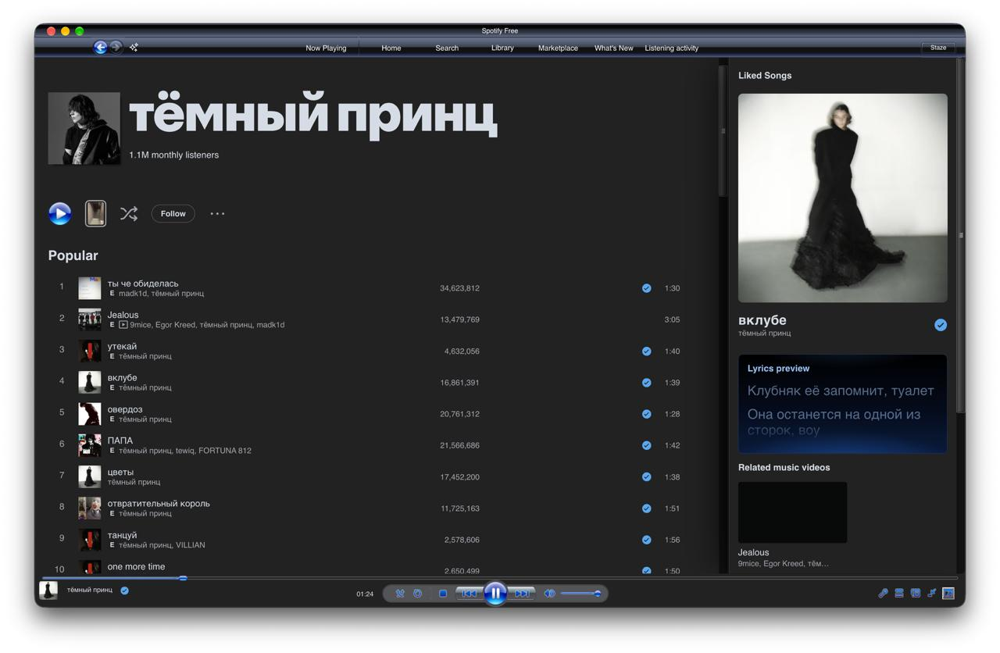
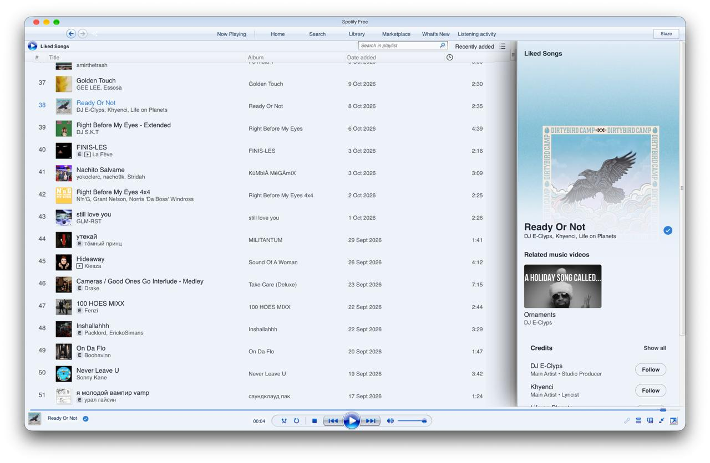
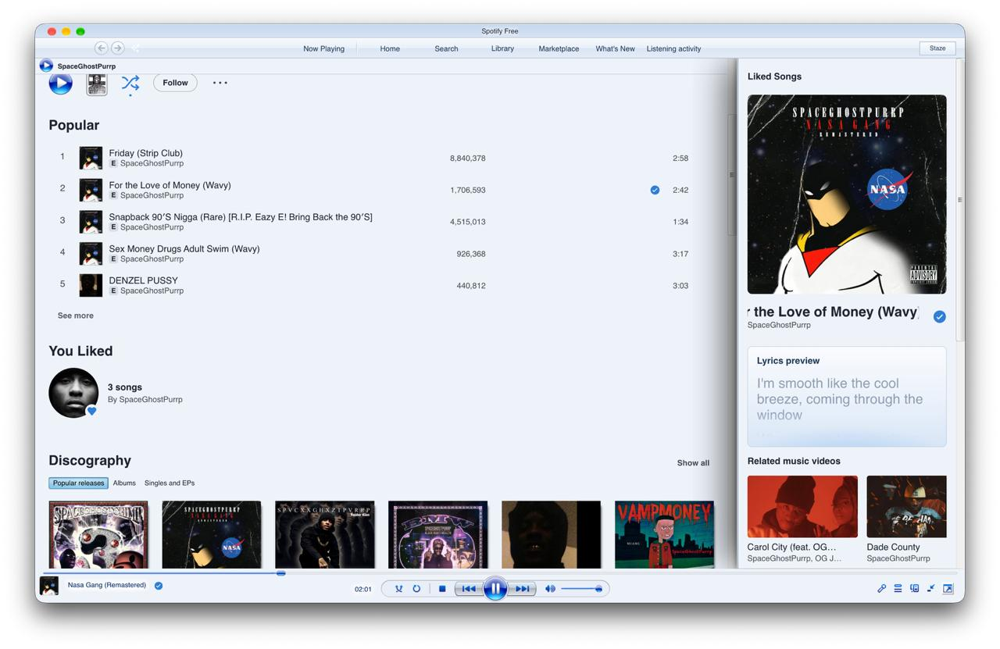

# MP12 — Windows Media Player 12 skin for Spotify

[WMPotify](https://github.com/Ingan121/WMPotify) restyled after Windows 7's Media Player: pale Aero glass in light mode, black glass in dark, matching lyrics. Works on current Spotify (tested on Spotify 1.3.10, Spicetify 2.46.7, macOS).

| Light | Dark |
|---|---|
|  |  |
|  |  |

## Install

1. Install [Spicetify](https://spicetify.app/docs/getting-started) and its Marketplace.
2. In Spotify: **Marketplace → Themes → WMPotify → Install**.
3. Run:

   ```sh
   git clone https://github.com/VladyslavHontar/MP12-spicetify-theme && cd MP12-spicetify-theme && ./install.sh
   ```

Restart Spotify. Remove with `./install.sh remove`.

**Light or dark:** WMPotify Properties → General → Dark mode → *Never* / *Always*. ("Follow system" can't work on macOS: Spotify forces its page to dark.)

## What's inside

- `extensions/wmpotify-compat.js` — makes WMPotify 1.2.7 work on Spotify 1.3.x.
- `extensions/wmpotify-skin.js` — the look. Delete it for stock WMPotify.
- `dev/check.mjs` — regression check (needs Node; run Spotify with `--remote-debugging-port=9222`).

Credits: WMPotify by [Ingan121](https://github.com/Ingan121).
